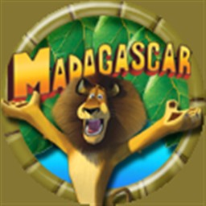
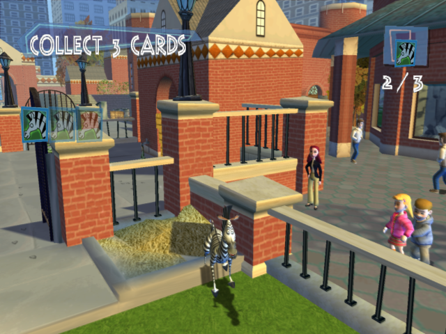
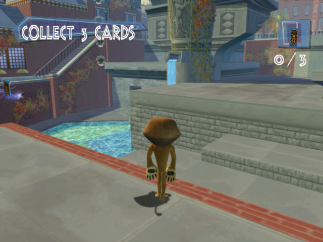

<div align="center">



# Madagascar (Xbox) for Nintendo Switch

A static recompilation port of the original Xbox Madagascar, running natively on the Switch.

   [](https://ko-fi.com/gerissoncassiano)

[Português (BR)](README.md) · **English** · [Español](README.es.md)

[Status](#status) · [Play](#play) · [Building](#building) · [Changelog](CHANGELOG.md) · [Support](#support-the-project)

</div>

---

An experimental static recompilation port: the Xbox's x86 executable is turned into C++ and compiled for ARM64 with the [XboxSwitchPortKit](kit/) and a Vulkan (NVK) renderer. This is not emulation: the game's code runs natively, and the Xbox libraries (Direct3D 8, DirectSound, kernel) are rewritten for the Switch.

> **This repository does not contain the game.** The disc files, the XBE and the C code generated from it are not distributed. To build or play you need your own copy of Madagascar (Xbox).

## Support the project

The port is free and the code is open. If you want to help with development time and testing on real Switch hardware, you can donate on Ko-fi:

[](https://ko-fi.com/gerissoncassiano)

Donations are optional: nobody has to donate to play, and the project neither includes nor sells the game.

## Status

Playable from the menu to gameplay, with audio, videos and the game's image effects (glow and depth of field).

What 0.1.7 has:

- Direct3D 8 rewritten in Vulkan (NVK), without emulating the NV2A GPU.
- Audio: sound effects, voices and streamed music.
- Bink videos.
- Depth of field as on the original: sharp gameplay, blurred background behind the menus and the demo.
- Threads spread across the Switch's three cores.
- **Port menu:** press **−** (Minus) and **R3** together. Render resolution, screen filter, brightness, V-Sync, FPS limit, FPS counter, anisotropic filtering, audio output and OLED SCREEN BOOST.
- Black side bars as on the original (the game is 4:3).
- No overclock needed.

Known issues:

- At stock clocks the frame rate still drops below 30 in parts of gameplay; with the GPU at 614 MHz it holds. Lowering the render resolution in the port menu (for example to 75%) helps.
- 0.1.7 is still being tested on real hardware.

## Screenshots

Taken from the PC test build, which runs the same game code and the same renderer as the Switch.

<p align="center"> </p>

## Controls

The controls are the original game's. The port adds:

| Button | Action |
| --- | --- |
| **−** + **R3** | Open and close the port menu |
| Left / right in the menu | Change the option's value |

## Game version used

The port was made and tested with this version. Other regions or revisions may not work, because the code depends on the exact executable.

| Field | Value |
| --- | --- |
| Game | Madagascar (Xbox, Toys for Bob / Activision, 2005) |
| Certificate region | `0x5` (North America + rest of world) |
| Title ID | `0x4156003B` |
| Certificate version | 5 |
| XBE built on | 2005-03-21 (XDK 5849) |
| `default.xbe` | 2,707,456 bytes |
| `default.xbe` SHA-256 | `5a21c1357e652971199c11bc7bb00ac1a9acf7a23d6b1ad321528e9d60b6444c` |

To check your copy in PowerShell:

```powershell
Get-FileHash .\game\default.xbe -Algorithm SHA256
```

## Play

You need your own copy of Madagascar (Xbox). Download `madagascar.nro` from [Releases](https://github.com/gerisson1996/MADAGASCAR-NX-PORT/releases/latest) and lay out the SD card like this:

```text
sdmc:/switch/madagascar/
  madagascar.nro
  game/              <- the disc files (default.xbe and the game folders) or an .iso
  logs/              <- created by the port
```

Launch it from hbmenu **while holding R on an installed game** (title mode, with the full memory).

## Building

The `kit/` folder has the port's and the kit's code, without the game and without the large binaries:

| Folder | What it is |
| --- | --- |
| `kit/exemplos/madagascar/` | The port: Direct3D 8 and DirectSound HLE, game hooks (`src/game/madagascar.cpp`), menu (`src/common`), `port.cmake`, `config/game.toml`, icon. |
| `kit/host-switch/` | Switch layer: Vulkan/NVK, audio, input, ImGui. |
| `kit/host-pc/` | Windows test build, with the same game code and the same renderer, to find bugs without the console. |
| `kit/sdk/XboxXBE-Recomp/` | The recompiler and runtime ([TGP482/XboxXBE-Recomp](https://github.com/TGP482/XboxXBE-Recomp), MIT), with the Switch changes. |
| `kit/ferramentas/`, `kit/docs/` | Recompile, build and packaging scripts, and the kit's documentation (Portuguese). |

Not in the repository, because of size or because they come from the game: `nvk/` (Mesa NVK driver built for the Switch), `third_party/` (glslang, Dear ImGui, toml++), `exemplos/madagascar/assets/default.xbe` and `exemplos/madagascar/generated/` (the C++ generated from your xbe).

Steps (details in [`kit/LEIA-ME.md`](kit/LEIA-ME.md) and [`kit/docs/`](kit/docs/)):

1. Copy `kit/` to a path without accents or spaces, for example `C:\XboxSwitchPortKit`, and add `nvk/` and `third_party/`.
2. Install Visual Studio 2022 Build Tools with Clang and devkitPro with `switch-dev` ([requirements](kit/docs/01-requisitos.md)).
3. Put your `default.xbe` in `exemplos\madagascar\assets\`.
4. Recompile, build and package:

```powershell
powershell -ExecutionPolicy Bypass -File C:\XboxSwitchPortKit\ferramentas\recompilar.ps1 C:\XboxSwitchPortKit\exemplos\madagascar
```

```bash
/c/devkitPro/msys2/usr/bin/bash.exe -lc 'cd /c/XboxSwitchPortKit && JOBS=8 ./ferramentas/build_switch.sh exemplos/madagascar'
```

```powershell
powershell -ExecutionPolicy Bypass -File C:\XboxSwitchPortKit\ferramentas\empacotar.ps1 C:\XboxSwitchPortKit\exemplos\madagascar
```

The result is `sd\switch\madagascar\madagascar.nro`.

## Changelog

See [CHANGELOG.md](CHANGELOG.md) (Portuguese).

## Licences and origin

- XboxXBE-Recomp (MIT), Black-Android, the base of `kit/exemplos/madagascar/src/common` (MIT, `kit/exemplos/madagascar/LICENSE-Black-Android`), Mesa/NVK (MIT), glslang, Dear ImGui and toml++ under their own licences. See `NOTICE`.
- Everything else follows `LICENSE` (MIT).
- Madagascar is a trademark of DreamWorks Animation; the Xbox game is by Toys for Bob / Activision. This project is not affiliated with them.
- Do not distribute the game files, the ISO or the generated code.
