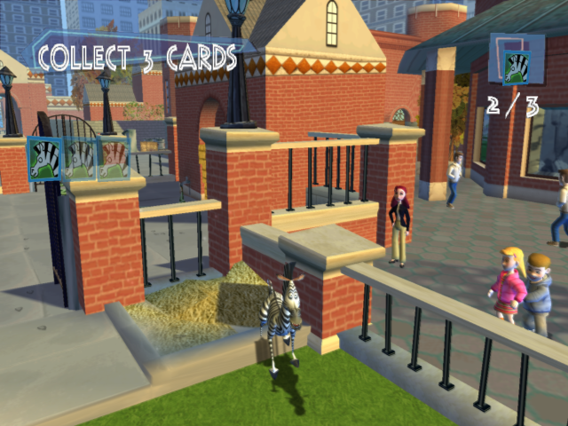
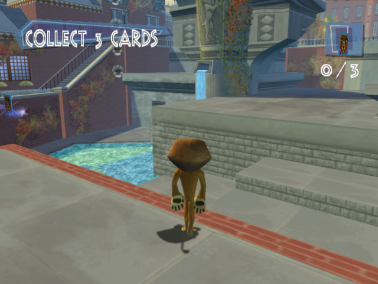

<div align="center">


# Madagascar (Xbox) para Nintendo Switch

Port por recompilación estática del Madagascar de la Xbox original, ejecutándose de forma nativa en la Switch.

   [](https://ko-fi.com/gerissoncassiano)

[Português (BR)](README.md) · [English](README.en.md) · **Español**

[Estado](#estado) · [Jugar](#jugar) · [Compilar](#compilar) · [Historial](CHANGELOG.md) · [Apoyar](#apoya-el-proyecto)

</div>

---

Port experimental por recompilación estática: el ejecutable x86 de la Xbox se convierte en C++ y se compila para ARM64 con el [XboxSwitchPortKit](kit/) y un renderizador Vulkan (NVK). No es emulación: el código del juego se ejecuta de forma nativa, y las bibliotecas de la Xbox (Direct3D 8, DirectSound, kernel) están reescritas para la Switch.

> **Este repositorio no contiene el juego.** Los archivos del disco, el XBE y el código C generado a partir de él no se distribuyen. Para compilar o jugar necesitas tu propia copia de Madagascar (Xbox).

## Apoya el proyecto

El port es gratis y el código es abierto. Si quieres ayudar con el tiempo de desarrollo y las pruebas en una Switch real, puedes donar por Ko-fi:

[](https://ko-fi.com/gerissoncassiano)

Donar es opcional: nadie tiene que donar para jugar, y el proyecto no incluye ni vende el juego.

## Estado

Jugable desde el menú hasta el gameplay, con audio, vídeos y los efectos de imagen del juego (brillo y desenfoque de profundidad).

Lo que tiene la 0.1.7:

- Direct3D 8 reescrito en Vulkan (NVK), sin emular la GPU NV2A.
- Audio: efectos, voces y música en streaming.
- Vídeos Bink.
- Desenfoque de profundidad como en el original: gameplay nítido, fondo de los menús y de la demo desenfocado.
- Hilos repartidos entre los tres núcleos de la Switch.
- **Menú del port:** pulsa **−** (Minus) y **R3** a la vez. Resolución de renderizado, filtro de pantalla, brillo, V-Sync, límite de FPS, contador de FPS, filtro anisotrópico, salida de audio y OLED SCREEN BOOST.
- Barras negras laterales como en el original (el juego es 4:3).
- Sin overclock.

Problemas conocidos:

- Con el reloj por defecto los FPS aún bajan de 30 en partes del gameplay; con la GPU a 614 MHz se mantienen. Bajar la resolución de renderizado en el menú del port (por ejemplo al 75%) ayuda.
- La 0.1.7 aún se está probando en la Switch real.

## Capturas

Capturas de la build de prueba para PC, que usa el mismo código del juego y el mismo renderizador que la Switch.

<p align="center"> </p>

## Controles

Los controles son los del juego original. El port añade:

| Botón | Función |
| --- | --- |
| **−** + **R3** | Abrir y cerrar el menú del port |
| Izquierda / derecha en el menú | Cambiar el valor de la opción |

## Versión del juego usada

El port se hizo y se probó con esta versión. Otras regiones o revisiones pueden no funcionar, porque el código depende del ejecutable exacto.

| Campo | Valor |
| --- | --- |
| Juego | Madagascar (Xbox, Toys for Bob / Activision, 2005) |
| Región del certificado | `0x5` (Norteamérica + resto del mundo) |
| Title ID | `0x4156003B` |
| Versión del certificado | 5 |
| XBE compilado el | 21/03/2005 (XDK 5849) |
| `default.xbe` | 2.707.456 bytes |
| SHA-256 del `default.xbe` | `5a21c1357e652971199c11bc7bb00ac1a9acf7a23d6b1ad321528e9d60b6444c` |

Para comprobar tu copia en PowerShell:

```powershell
Get-FileHash .\game\default.xbe -Algorithm SHA256
```

## Jugar

Necesitas tu propia copia de Madagascar (Xbox). Descarga `madagascar.nro` desde [Releases](https://github.com/gerisson1996/MADAGASCAR-NX-PORT/releases/latest) y organiza la tarjeta así:

```text
sdmc:/switch/madagascar/
  madagascar.nro
  game/              <- los archivos del disco (default.xbe y las carpetas del juego) o un .iso
  logs/              <- lo crea el port
```

Ábrelo desde hbmenu **manteniendo R al abrir un juego instalado** (modo título, con toda la memoria).

## Compilar

La carpeta `kit/` tiene el código del port y del kit, sin el juego y sin los binarios grandes. Las carpetas y los pasos están detallados en el [README en portugués](README.md#compilar): copia `kit/` a `C:\XboxSwitchPortKit`, añade `nvk/` y `third_party/`, pon tu `default.xbe` en `exemplos\madagascar\assets\` y ejecuta:

```powershell
powershell -ExecutionPolicy Bypass -File C:\XboxSwitchPortKit\ferramentas\recompilar.ps1 C:\XboxSwitchPortKit\exemplos\madagascar
```

```bash
/c/devkitPro/msys2/usr/bin/bash.exe -lc 'cd /c/XboxSwitchPortKit && JOBS=8 ./ferramentas/build_switch.sh exemplos/madagascar'
```

```powershell
powershell -ExecutionPolicy Bypass -File C:\XboxSwitchPortKit\ferramentas\empacotar.ps1 C:\XboxSwitchPortKit\exemplos\madagascar
```

El resultado queda en `sd\switch\madagascar\madagascar.nro`.

## Historial de versiones

Ver [CHANGELOG.md](CHANGELOG.md) (en portugués).

## Licencias y origen

- XboxXBE-Recomp (MIT), Black-Android, base de `kit/exemplos/madagascar/src/common` (MIT, `kit/exemplos/madagascar/LICENSE-Black-Android`), Mesa/NVK (MIT), glslang, Dear ImGui y toml++ bajo sus licencias. Ver `NOTICE`.
- El resto sigue `LICENSE` (MIT).
- Madagascar es una marca de DreamWorks Animation; el juego de Xbox es de Toys for Bob / Activision. Este proyecto no tiene relación con ellos.
- No distribuyas los archivos del juego, la ISO ni el código generado.
