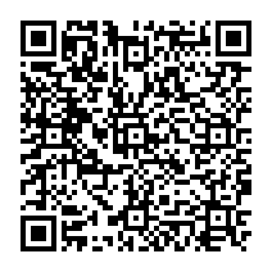
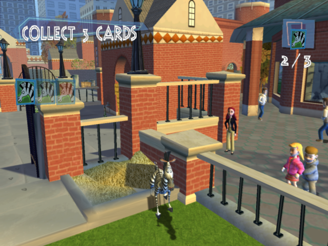
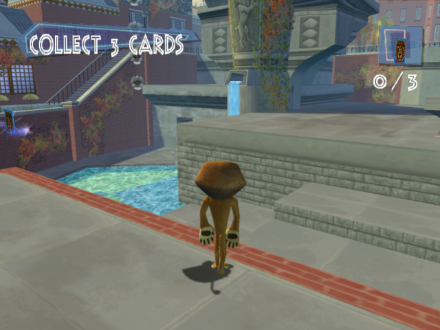

<div align="center">


# Madagascar (Xbox) para Nintendo Switch

Port por recompilação estática do Madagascar do Xbox original, rodando nativo no Switch.

   [](https://ko-fi.com/gerissoncassiano)

**Português (BR)** · [English](README.en.md) · [Español](README.es.md)

[Estado](#estado) · [Jogar](#jogar) · [Compilar](#compilar) · [Histórico](CHANGELOG.md) · [Apoiar](#apoie-o-projeto)

</div>

---

Port experimental por recompilação estática: o executável x86 do Xbox vira C++, compilado para ARM64, com o [XboxSwitchPortKit](kit/) e um renderizador Vulkan (NVK). Não é emulação: o código do jogo roda nativo, e as bibliotecas do Xbox (Direct3D 8, DirectSound, kernel) são reescritas para o Switch.

> **Este repositório não contém o jogo.** Os arquivos do disco, o XBE e o código C gerado a partir dele não são distribuídos. Para compilar ou jogar você precisa da sua própria cópia de Madagascar (Xbox).

## Apoie o projeto

O port é grátis e o código é aberto. Se quiser ajudar no tempo de desenvolvimento e nos testes no Switch real, você pode doar pelo Ko-fi:

[](https://ko-fi.com/gerissoncassiano)

Ou por **PIX** (chave e-mail): `pocketneogames@gmail.com`



PIX copia e cola:

```text
00020126460014br.gov.bcb.pix0124pocketneogames@gmail.com5204000053039865802BR5911RECOMP GUTO6006BRASIL62070503***63048D6B
```

Doação é opcional: ninguém precisa doar para jogar, e o projeto não inclui nem vende o jogo.

## Estado

Jogável do menu ao gameplay, com áudio, vídeos e os efeitos de imagem do jogo (brilho e desfoque de profundidade).

O que a 0.1.7 tem:

- Direct3D 8 reescrito em Vulkan (NVK), sem emular a GPU NV2A.
- Áudio: efeitos, vozes e música em streaming.
- Vídeos Bink.
- Desfoque de profundidade igual ao original: gameplay nítido, fundo dos menus e da demo desfocado.
- Threads distribuídas pelos três núcleos do Switch.
- **Menu do port:** aperte **−** (Minus) e **R3** juntos. Resolução de renderização, filtro de tela, brilho, V-Sync, limite de FPS, contador de FPS, filtro anisotrópico, saída de áudio e OLED SCREEN BOOST.
- Faixas pretas nas laterais como no original (o jogo é 4:3).
- Sem overclock.

Problemas conhecidos:

- No clock padrão o FPS ainda cai abaixo de 30 em partes do gameplay; com a GPU em 614 MHz fica estável. Baixar a resolução de renderização no menu do port (por exemplo 75%) ajuda.
- A 0.1.7 ainda está sendo testada no Switch real.

## Capturas

Capturas da build de teste para PC, que usa o mesmo código do jogo e o mesmo renderizador do Switch.

<p align="center"> </p>

## Controles

Os controles são os do jogo original. O port acrescenta:

| Botão | Função |
| --- | --- |
| **−** + **R3** | Abrir e fechar o menu do port |
| Esquerda / direita no menu | Mudar o valor da opção |

## Versão do jogo usada

O port foi feito e testado com esta versão. Outras regiões ou revisões podem não funcionar, porque o código depende do executável exato.

| Campo | Valor |
| --- | --- |
| Jogo | Madagascar (Xbox, Toys for Bob / Activision, 2005) |
| Região do certificado | `0x5` (América do Norte + resto do mundo) |
| Title ID | `0x4156003B` |
| Versão do certificado | 5 |
| XBE compilado em | 21/03/2005 (XDK 5849) |
| `default.xbe` | 2.707.456 bytes |
| SHA-256 do `default.xbe` | `5a21c1357e652971199c11bc7bb00ac1a9acf7a23d6b1ad321528e9d60b6444c` |

Para conferir a sua cópia no PowerShell:

```powershell
Get-FileHash .\game\default.xbe -Algorithm SHA256
```

## Jogar

Você precisa da sua própria cópia de Madagascar (Xbox). Baixe o `madagascar.nro` em [Releases](https://github.com/gerisson1996/MADAGASCAR-NX-PORT/releases/latest) e monte o cartão assim:

```text
sdmc:/switch/madagascar/
  madagascar.nro
  game/              <- os arquivos do disco (default.xbe e as pastas do jogo) ou um .iso
  logs/              <- criado pelo port
```

Abra pelo hbmenu **segurando R ao abrir um jogo instalado** (modo título, com a memória inteira).

## Compilar

A pasta `kit/` tem o código do port e do kit, sem o jogo e sem os binários grandes:

| Pasta | O que é |
| --- | --- |
| `kit/exemplos/madagascar/` | O port: HLE do Direct3D 8 e do DirectSound, hooks do jogo (`src/game/madagascar.cpp`), menu (`src/common`), `port.cmake`, `config/game.toml`, ícone. |
| `kit/host-switch/` | Camada do Switch: Vulkan/NVK, áudio, controles, ImGui. |
| `kit/host-pc/` | Build de teste para Windows, com o mesmo código do jogo e o mesmo renderizador, para achar bugs sem o console. |
| `kit/sdk/XboxXBE-Recomp/` | O recompilador e o runtime ([TGP482/XboxXBE-Recomp](https://github.com/TGP482/XboxXBE-Recomp), MIT), com as mudanças para o Switch. |
| `kit/ferramentas/`, `kit/docs/` | Scripts de recompilar, compilar e empacotar, e a documentação do kit. |

Não estão no repositório, por tamanho ou por serem do jogo: `nvk/` (driver Mesa NVK compilado para o Switch), `third_party/` (glslang, Dear ImGui, toml++), `exemplos/madagascar/assets/default.xbe` e `exemplos/madagascar/generated/` (o código C++ gerado do seu xbe).

Passos (detalhes em [`kit/LEIA-ME.md`](kit/LEIA-ME.md) e [`kit/docs/`](kit/docs/)):

1. Copie `kit/` para um caminho sem acento nem espaço, por exemplo `C:\XboxSwitchPortKit`, e complete com `nvk/` e `third_party/`.
2. Instale o Visual Studio 2022 Build Tools com Clang e o devkitPro com `switch-dev` ([requisitos](kit/docs/01-requisitos.md)).
3. Coloque o seu `default.xbe` em `exemplos\madagascar\assets\`.
4. Recompile, compile e empacote:

```powershell
powershell -ExecutionPolicy Bypass -File C:\XboxSwitchPortKit\ferramentas\recompilar.ps1 C:\XboxSwitchPortKit\exemplos\madagascar
```

```bash
/c/devkitPro/msys2/usr/bin/bash.exe -lc 'cd /c/XboxSwitchPortKit && JOBS=8 ./ferramentas/build_switch.sh exemplos/madagascar'
```

```powershell
powershell -ExecutionPolicy Bypass -File C:\XboxSwitchPortKit\ferramentas\empacotar.ps1 C:\XboxSwitchPortKit\exemplos\madagascar
```

O resultado fica em `sd\switch\madagascar\madagascar.nro`.

## Estrutura do repositório

| Pasta | Conteúdo |
| --- | --- |
| `kit/` | O port e o kit usado para compilá-lo |
| `docs/img/` | Capturas |
| `artwork/` | Ícone |
| `CHANGELOG.md` | Histórico de versões |

## Histórico de versões

Veja [CHANGELOG.md](CHANGELOG.md).

## Licenças e origem

- XboxXBE-Recomp (MIT), Black-Android, base de `kit/exemplos/madagascar/src/common` (MIT, `kit/exemplos/madagascar/LICENSE-Black-Android`), Mesa/NVK (MIT), glslang, Dear ImGui e toml++ nas licenças deles. Veja `NOTICE`.
- O restante segue `LICENSE` (MIT).
- Madagascar é marca da DreamWorks Animation; o jogo de Xbox é da Toys for Bob / Activision. Este projeto não tem ligação com eles.
- Não distribua os arquivos do jogo, a ISO nem o código gerado.
